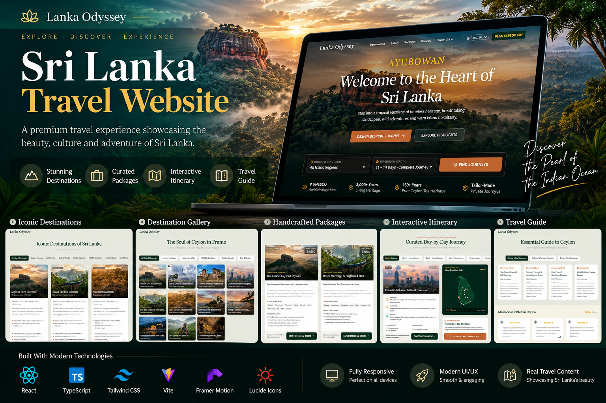
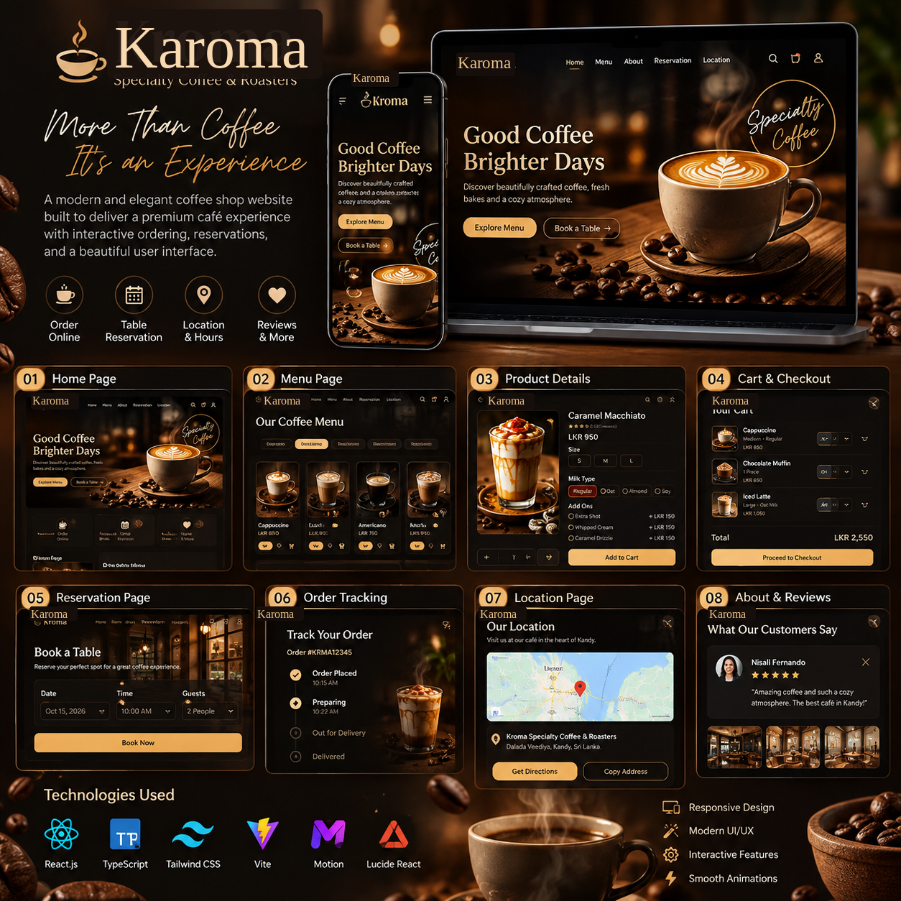
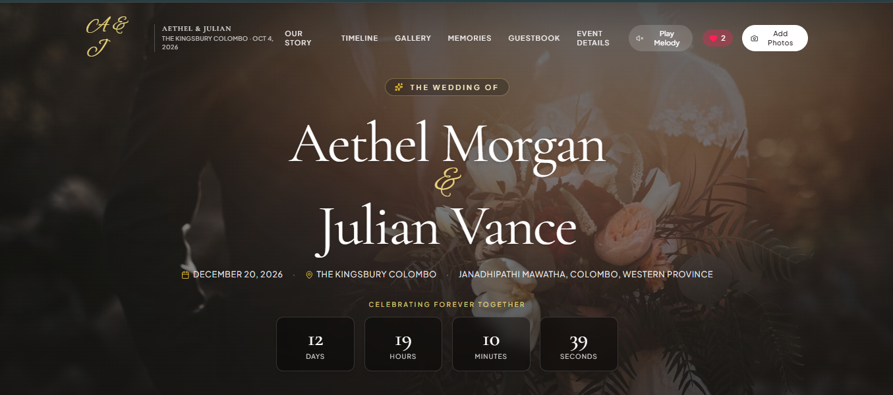
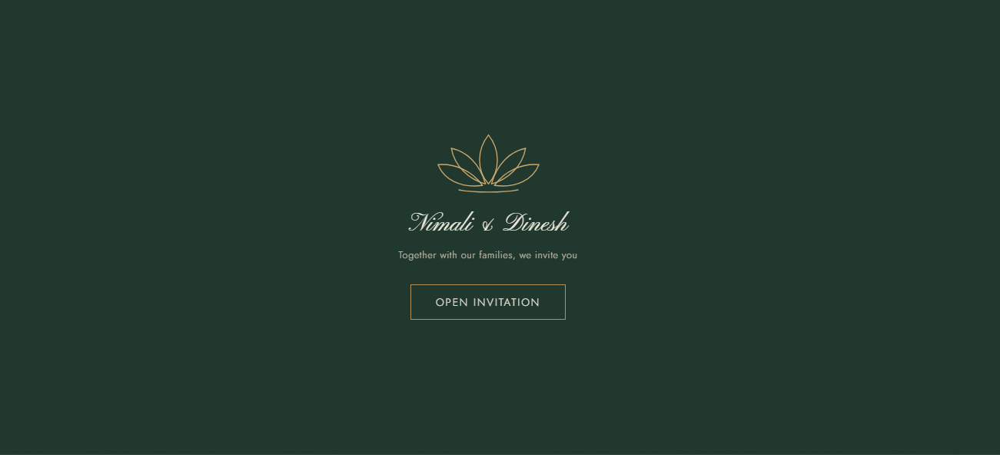
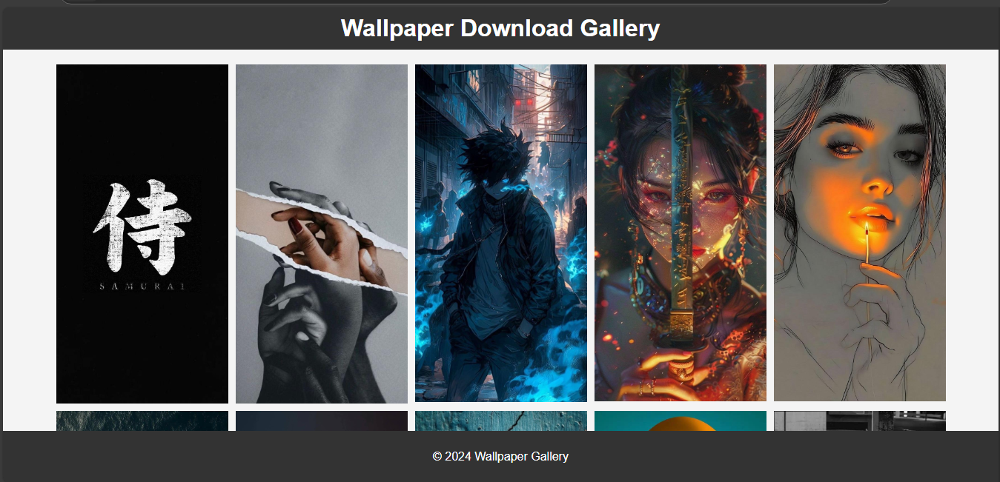
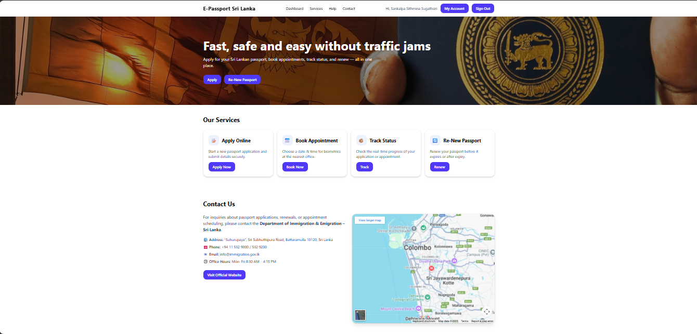
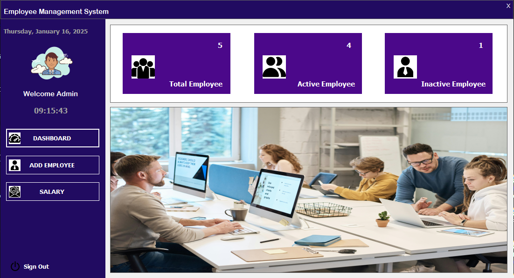
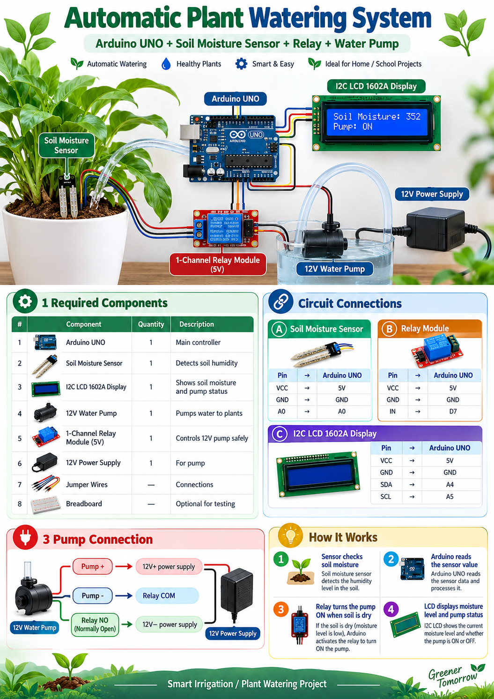

<div align="center">
  
  <br /><br />

  # SANKALPA — Creative Portfolio

  **A digital space where design, code, and motion come together.**

  An interactive personal portfolio for **Sankalpa Sithmina**, Creative Developer & UI/UX Designer based in Sri Lanka.

  [**🌐 Live Portfolio**](https://sana1211.github.io/sankalpa-sithmina-26/) · [**💻 GitHub**](https://github.com/sana1211) · [**💼 LinkedIn**](https://www.linkedin.com/in/sankalpa-sithmina) · [**✉️ Contact**](mailto:sankalpasithmina18@gmail.com)

  <br />
  
  
  
  
  
  
</div>

---

## ✦ Overview

**SANKALPA** is a responsive, motion-led portfolio built to present selected web, desktop, and embedded-systems projects alongside my skills, education, certifications, and contact information. A custom **interactive 3D hanging ID card** sets the tone, followed by an editorial project gallery and carefully designed content sections.

The experience combines a navy-and-violet aesthetic, subtle transitions, detailed project previews, and layouts designed for desktop, tablet, and mobile screens.

## ✦ Highlights

- **Interactive 3D identity card** — drag to move, click to flip; includes a 2D fallback for unsupported or reduced-motion environments.
- **Eight featured projects** — categorized, filterable project cards with details, technology tags, screenshots, and available links.
- **UI/UX and project previews** — real screenshots included in the repository, displayed without relying on external image hosts.
- **Responsive interface** — desktop navigation, mobile menu, adaptable cards, and touch-friendly layouts.
- **Motion and visual detail** — page preloader, scroll progress indicator, reveal animations, and interactive effects.
- **Skills and education** — filterable technical skills, education timeline, and technology icons.
- **Certificates gallery** — certificate images with preview and download options.
- **Contact experience** — EmailJS integration when configured, with an email-app fallback otherwise.
- **Downloadable CV** — available from the public assets folder.

## ✦ UI/UX Design & Project Previews

These are **actual screenshots from the projects included in this repository**, not Figma mockups. Click any preview to view the full-size image. All image paths are relative to the repository root, so they work directly in a GitHub README.

<table>
  <tr>
    <td width="50%" valign="top">
      <a href="./public/projects/lanka-odyssey.png"></a>
      <br /><b>01 / Lanka Odyssey</b><br />Travel website · Destination and itinerary UI
    </td>
    <td width="50%" valign="top">
      <a href="./public/projects/karoma-coffee.png"></a>
      <br /><b>02 / Premium Coffee Shop</b><br />Coffee shop · Cinematic commerce UI
    </td>
  </tr>
  <tr>
    <td width="50%" valign="top">
      <a href="./public/projects/wedding-gallery.png"></a>
      <br /><b>03 / Wedding Gallery</b><br />Storytelling · Gallery UI
    </td>
    <td width="50%" valign="top">
      <a href="./public/projects/wedding-invitation.png"></a>
      <br /><b>04 / Wedding Invitation</b><br />Invitation · RSVP experience
    </td>
  </tr>
  <tr>
    <td width="50%" valign="top">
      <a href="./public/projects/wallpaper-gallery.png"></a>
      <br /><b>06 / Wallpaper Download Gallery</b><br />Visual discovery · Gallery layout
    </td>
    <td width="50%" valign="top">
      <a href="./public/projects/e-passport-sri-lanka.png"></a>
      <br /><b>07 / E-Passport Sri Lanka</b><br />Service portal · Application UI prototype
    </td>
  </tr>
  <tr>
    <td width="50%" valign="top">
      <a href="./public/projects/employee-management.png"></a>
      <br /><b>08 / Employee Management System</b><br />Desktop application · HR dashboard
    </td>
    <td width="50%" valign="top">
      <a href="./public/projects/automatic-plant-watering.png"></a>
      <br /><b>05 / Automatic Plant Watering System</b><br />Embedded systems · Smart irrigation project
    </td>
  </tr>
</table>

> **Note:** The E-Passport Sri Lanka project is a student/portfolio **UI prototype**, not an official government service. The plant-watering image is a hardware-project poster rather than an application interface.

## ✦ Selected Projects

| # | Project | Category | Links |
|:--:|---|---|---|
| 01 | **Lanka Odyssey** — Sri Lanka destinations, curated tours, itineraries, and travel galleries | Web Development | [Live](https://sana1211.github.io/srilanka-travel/) · [Source](https://github.com/sana1211/srilanka-travel) |
| 02 | **Premium Coffee Shop (Karoma)** — interactive menu, reservation and order interfaces | Web Development | [Live](https://sana1211.github.io/karoma-coffee/) · [Source](https://github.com/sana1211/karoma-coffee) |
| 03 | **Wedding Gallery Celebration Story** — photo gallery, event timeline and guestbook | Web Development | [Live](https://sana1211.github.io/wedding-gallery-celebration) · [Source](https://github.com/sana1211/wedding-gallery-celebration) |
| 04 | **Wedding Invitation Website** — ceremony details, countdown and RSVP experience | Web Development | [Live](https://sana1211.github.io/Wedding-invitation/) · [Source](https://github.com/sana1211/Wedding-invitation) |
| 05 | **Automatic Plant Watering System** — Arduino-based moisture monitoring and pump control | IoT & Embedded Systems | [Source](https://github.com/sana1211/Automatic_Plant_Watering_System) |
| 06 | **Wallpaper Download Gallery** — curated wallpaper browsing experience | Web Applications | Screenshot above |
| 07 | **E-Passport Sri Lanka** — passport-service portal concept | Web Applications | Prototype screenshot above |
| 08 | **Employee Management System** — employee statistics, records and salary interface | Desktop Applications | Screenshot above |

Project descriptions, screenshots, categories, and optional demo/source URLs can be edited in [`src/data.ts`](./src/data.ts).

## ✦ Technology Stack

| Area | Technologies |
|---|---|
| **Frontend** | React 19, TypeScript, Vite 7, Tailwind CSS 4 |
| **3D & animation** | Three.js, React Three Fiber, Motion |
| **UI & icons** | Lucide React, custom CSS, Google Fonts |
| **Contact** | EmailJS (optional), `mailto:` fallback |
| **Deployment** | GitHub Pages / static hosting |

The portfolio also *showcases* experience with Next.js, Node.js, Python, MongoDB, PostgreSQL, Figma, and other tools in its skills section; those are not all runtime dependencies of this website.

## ✦ Run Locally

**Requirements:** Node.js compatible with Vite 7 (Node.js 20.19+ or 22.12+) and npm.

```bash
git clone https://github.com/sana1211/sankalpa-sithmina-26.git
cd sankalpa-sithmina-26
npm ci
npm run dev
```

Open the local URL printed by Vite (usually `http://localhost:5173/`).

### Production build

```bash
npm run build
npm run preview
```

The production-ready site is generated in `dist/`.

## ✦ Configure the Contact Form (Optional)

The site supports EmailJS. Without configuration, submitting the form opens the visitor's default email app with a prefilled message.

1. Copy `.env.example` to `.env.local`.
2. Create an EmailJS service and template.
3. Enter your own browser-side identifiers:

```env
VITE_EMAILJS_SERVICE_ID=your_service_id
VITE_EMAILJS_TEMPLATE_ID=your_template_id
VITE_EMAILJS_PUBLIC_KEY=your_public_key
```

4. Restart the development server. For GitHub Pages builds, provide these variables to the build workflow if you want EmailJS enabled on the published site.

> Vite `VITE_` variables are included in the browser bundle. Never place private API secrets or credentials in these fields. `.env.local` is ignored by Git.

## ✦ Project Structure

```text
.
├── public/
│   ├── projects/            # Eight project screenshots / poster
│   ├── certificates/        # Certificate image assets
│   ├── skill-logos/          # Technology logos
│   └── W.M.Sankalpa Sithmina.pdf
├── src/
│   ├── assets/              # Portfolio branding and 3D badge assets
│   ├── components/
│   │   ├── layout/          # Nav, footer, preloader, cursor, progress
│   │   ├── projects/        # Project screenshots and detail modal
│   │   ├── sections/        # Hero, work, about, education, skills, contact
│   │   └── ThreeHeroStage.tsx
│   ├── data.ts              # Projects, profile, skills, certificates, education
│   ├── responsive.css
│   └── App.tsx
├── .env.example
├── package.json
└── vite.config.ts
```

## ✦ Deploy to GitHub Pages

This project is a Vite static site. `vite.config.ts` already uses `base: './'` so generated asset URLs work under a GitHub Pages repository path.

1. Push the repository to GitHub.
2. Under **Settings → Pages**, select **GitHub Actions** as the deployment source.
3. Configure a GitHub Actions workflow that runs `npm ci`, then `npm run build`, and deploys the generated `dist/` folder.
4. Check the **Actions** tab for a successful run.

**Portfolio:** https://sana1211.github.io/sankalpa-sithmina-26/

> A GitHub Pages workflow file is **not included** in the supplied ZIP; if your GitHub repository already has a deployment workflow, keep using that existing file.

## ✦ About the Developer

I'm **Sankalpa Sithmina**, a Sri Lankan creative developer and UI/UX designer pursuing a **Bachelor of Information Technology (BIT)** at the **University of Moratuwa**. I enjoy blending interface design, frontend engineering, and motion to create digital experiences with a distinct visual identity.

- **Portfolio:** [sana1211.github.io/sankalpa-sithmina-26](https://sana1211.github.io/sankalpa-sithmina-26/)
- **GitHub:** [@sana1211](https://github.com/sana1211)
- **LinkedIn:** [Sankalpa Sithmina](https://www.linkedin.com/in/sankalpa-sithmina)
- **Email:** [sankalpasithmina18@gmail.com](mailto:sankalpasithmina18@gmail.com)

---

<div align="center">
  <sub>Designed and developed with care by <b>Sankalpa Sithmina</b> · © 2026</sub>
  <br />
  <sub>Code is the medium. Imagination is the limit.</sub>
</div>
